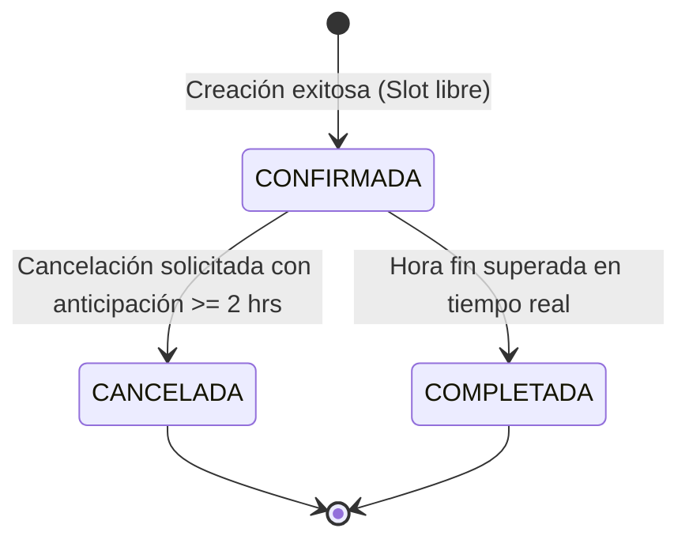

# Especificación de Reglas de Negocio (SDD — Business Rules)

**Proyecto:** Sistema de Reservas Especializado de Canchas Deportivas (`CanchaYa`)  
**Curso:** Tópicos Especiales II — Prof. Regis Rivera  
**Rol Responsable:** Estudiante 1 — Product / Spec Lead (Ivan Wu)  
**Versión:** 1.0.0  
**Fecha:** Noviembre 2026  

---

## 1. Reglas Críticas del Sistema

### BR-01: Prevención Absoluta de Doble Reserva (Anticolisión) — **OBLIGATORIA**
* **Descripción:** Dos reservas para la misma cancha física nunca pueden coexistir en el mismo instante de tiempo si ambas tienen estado activo (`CONFIRMADA`).
* **Definición Matemática del Conflicto de Horario:**
  Dada una reserva existente $E$ con intervalo $[E_{start}, E_{end})$ y una nueva solicitud $N$ con intervalo $[N_{start}, N_{end})$ para la misma cancha $C$:
  $$\text{Existe Conflicto} \iff (N_{start} < E_{end}) \land (N_{end} > E_{start}) \land (E_{status} = \text{'CONFIRMADA'})$$
* **Casos de Violación Contemplados:**
  1. **Solapamiento Idéntico:** $N_{start} = E_{start}$ y $N_{end} = E_{end}$.
  2. **Solapamiento Interno:** $N$ está completamente contenido dentro de $E$.
  3. **Solapamiento Envolvente:** $N$ contiene completamente a $E$.
  4. **Solapamiento por Inicio:** $N_{start} < E_{start} < N_{end}$.
  5. **Solapamiento por Fin:** $N_{start} < E_{end} < N_{end}$.
* **Acción ante Conflicto:** La transacción debe ser rechazada atómicamente, emitiendo un error HTTP `409 Conflict` con el mensaje:  
  `"La cancha solicitada no está disponible en el horario seleccionado."`
* **Excepción:** Si una reserva previa tiene estado `CANCELADA`, su intervalo horario queda liberado inmediatamente y puede ser tomado por una nueva reserva.

---

### BR-02: Rango Operativo y Modularidad de Slots
* **Horario de Operación:** El complejo opera exclusivamente de **08:00 a 23:00** horas locales (lunes a domingo).
* **Duración Estándar del Turno:** Los turnos se comercializan en bloques discretos de **60 minutos**.
  * Ejemplos válidos: 08:00 - 09:00, 19:00 - 20:00, 22:00 - 23:00.
  * Turnos inválidos: 08:30 - 09:15 (fraccionamiento no estándar), 23:00 - 00:00 (fuera de horario).
* **Restricción de Tiempo Pasado:** No se permite crear reservas con fecha u hora de inicio anterior al timestamp actual del sistema (`N_{start} > Now()`).
* **Límite de Anticipación Máxima:** Un cliente puede reservar con un máximo de **30 días** de anticipación respecto a la fecha actual.

---

### BR-03: Modelo Sin Cuenta (Guest Booking) e Identificador Único
* **Identificación del Cliente:** No existe formulario de login ni contraseña. El cliente solo provee:
  * `customer_name`: Nombre y apellido (longitud: 3 a 80 caracteres).
  * `customer_phone`: Número de contacto válido (mínimo 7 dígitos).
  * `customer_email`: Correo electrónico con formato RFC válido.
* **Generación del Código Localizador (`booking_id`):**
  * Todo registro exitoso debe generar un código alfanumérico único e irrepetible.
  * Formato estándar recomendado: Prefijo `CY-` seguido de año y 4 o 6 caracteres alfanuméricos en mayúsculas (ej: `CY-2026-A78K`) o un UUID versión 4 corto.
  * Este código es la credencial única para que el cliente consulte o cancele su reserva.

---

### BR-04: Máquina de Estados de la Reserva

* **Transiciones Válidas:**
  1. `[*] -> CONFIRMADA`: Al persistir una reserva que no colisiona.
  2. `CONFIRMADA -> CANCELADA`: Únicamente si se cumple la regla temporal BR-05.
  3. `CONFIRMADA -> COMPLETADA`: Proceso automático del sistema una vez transcurrido el horario del partido.
* **Inmutabilidad:** Una reserva en estado `CANCELADA` o `COMPLETADA` no puede volver a cambiar de estado ni editarse.

---

### BR-05: Ventana Temporal de Cancelación
* **Plazo Límite de Cancelación:** Un cliente puede cancelar su reserva mediante su `booking_id` siempre y cuando la solicitud ocurra con **al menos 2 horas (120 minutos)** de anticipación respecto a $N_{start}$.
  $$\text{Cancelación Permitida} \iff (N_{start} - \text{Timestamp Actual}) \ge 120\text{ minutos}$$
* **Intento Tardío:** Si el cliente intenta cancelar con menos de 2 horas de anticipación, el sistema rechazará la acción devolviendo HTTP `422 Unprocessable Entity` o `400 Bad Request` con el mensaje:
  `"No es posible cancelar la reserva: el plazo límite es de 2 horas previas al inicio del turno."`

---

### BR-06: Preparación para Cambio Inesperado de Requerimiento (Ciclo 2)
*(Requisito curricular del Proyecto 2: introducción de un cambio no planificado a mitad del desarrollo)*
* **Candidato Principal de Cambio de Requerimiento:**
  * **Regla BR-06A (Buffer de Mantenimiento entre Turnos):** Se introducirá la exigencia de un margen de seguridad de 15 minutos de limpieza y riego de cancha entre partidos consecutivos, modificando el cálculo de colisiones.
  * *O alternativamente:*
  * **Regla BR-06B (Suplemento de Iluminación Nocturna):** Las reservas que inicien a partir de las 18:00 deben incluir obligatoriamente el servicio de iluminación en la tarifa y confirmación.
* Esta regla se mantiene en borrador de producto y se inyectará formalmente durante la simulación de cambio para evidenciar la trazabilidad solicitada por el profesor.
