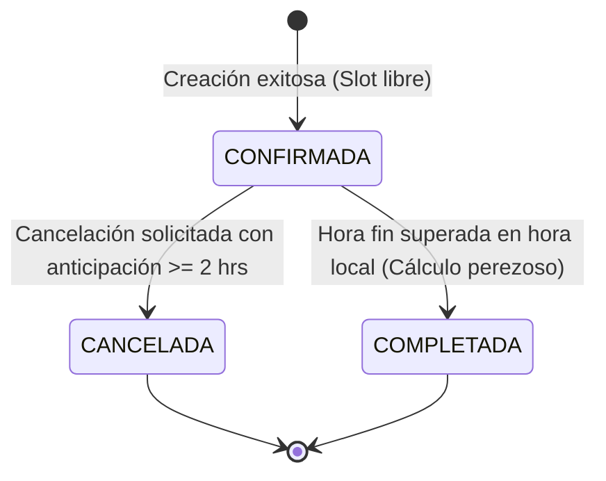

# Especificación de Reglas de Negocio (SDD — Business Rules)

**Proyecto:** Sistema de Reservas Especializado de Canchas Deportivas (`CanchaYa`)  
**Curso:** Tópicos Especiales II — Prof. Regis Rivera  
**Rol Responsable:** Estudiante 1 — Product / Spec Lead (Ivan Wu)  
**Versión:** 1.0.0  
**Fecha:** Noviembre 2026  

---

## 1. Reglas Críticas del Sistema

### BR-01: Prevención Absoluta de Doble Reserva (Anticolisión) — **OBLIGATORIA**
* **Descripción:** Dos reservas para la misma cancha física nunca pueden coexistir en el mismo instante de tiempo si ambas tienen estado activo (`CONFIRMADA`).
* **Definición Matemática del Conflicto de Horario:**
  Dada una reserva existente $E$ con intervalo $[E_{start}, E_{end})$ y una nueva solicitud $N$ con intervalo $[N_{start}, N_{end})$ para la misma cancha $C$:
  $$\text{Existe Conflicto} \iff (N_{start} < E_{end}) \land (N_{end} > E_{start}) \land (E_{status} = \text{'CONFIRMADA'})$$
* **Casos de Solapamiento Teórico Contemplados:**
  1. **Solapamiento Idéntico:** $N_{start} = E_{start}$ y $N_{end} = E_{end}$.
  2. **Solapamiento Interno:** $N$ está completamente contenido dentro de $E$.
  3. **Solapamiento Envolvente:** $N$ contiene completamente a $E$.
  4. **Solapamiento por Inicio:** $N_{start} < E_{start} < N_{end}$.
  5. **Solapamiento por Fin:** $N_{start} < E_{end} < N_{end}$.
* **Ámbito de Verificación:**
  * La fórmula matemática de solapamiento y sus 5 casos se comprueban de manera aislada como **pruebas unitarias de dominio** (`tests/unit/collision.test.ts`).
  * En la API REST pública, las peticiones que no inicien en hora en punto (ej. 17:30) son rechazadas previamente con **HTTP 400** por violación de horario BR-02 en la tubería de validación, por lo que a la capa de colisión BR-01 únicamente llegan slots íntegros de hora exacta, donde el conflicto se detecta y rechaza con **HTTP 409 Conflict**.
* **Acción ante Conflicto:** La transacción debe ser rechazada atómicamente, emitiendo un error HTTP `409 Conflict` con el mensaje:  
  `"La cancha solicitada no está disponible en el horario seleccionado."`
* **Excepción:** Si una reserva previa tiene estado `CANCELADA`, su intervalo horario queda liberado inmediatamente y puede ser tomado por una nueva reserva.

---

### BR-02: Rango Operativo, Modularidad de Slots y Zona Horaria
* **Zona Horaria Oficial del Complejo:** Todo el cálculo de horarios, validaciones de tiempo y restricciones se rige estrictamente bajo la zona horaria **`America/Panama` (UTC−5, sin horario de verano / DST)**. Los registros de persistencia y auditoría interna almacenan timestamps en formato UTC (ISO 8601 con sufijo `Z`).
* **Horario de Operación:** El complejo opera exclusivamente de **08:00 a 23:00** hora local de Panamá (lunes a domingo).
* **Duración Estándar y Modularidad del Turno:** Los turnos se comercializan exclusivamente en bloques discretos de **60 minutos**, iniciando siempre en hora exacta (`:00`).
  * Ejemplos válidos: 08:00 - 09:00, 19:00 - 20:00, 22:00 - 23:00.
  * Turnos inválidos: 08:30 - 09:15 (fraccionamiento no estándar), 17:30 - 18:30 (inicio en media hora), 23:00 - 00:00 (fuera de horario operativo). Toda petición con hora no exacta se rechaza con **HTTP 400 Bad Request** (`INVALID_TIME_SLOT`).
* **Cálculo Servidor de `end_time`:** El cliente envía únicamente `start_time` (ej. `"18:00"`). El servidor calcula internamente `end_time = start_time + 60 min` (`"19:00"`).
* **Restricción de Tiempo Pasado:** No se permite crear reservas con fecha u hora de inicio anterior al timestamp actual en Panamá (`N_{start} \le Now()`). Peticiones en el pasado retornan **HTTP 400 Bad Request** con mensaje: `"No se pueden agendar reservas en fechas u horas pasadas."`.
* **Disponibilidad de Slots Pasados en el Día:** En la consulta de disponibilidad del día actual, los slots cuya hora de inicio ya haya transcurrido se devuelven con estado `PASADO` (`available: false`).
* **Límite de Anticipación Máxima (30 Días):** Un cliente puede reservar con un máximo estricto de **30 días calendario** de anticipación respecto a la fecha actual local (`booking_date \le Today() + 30`). Si la fecha supera este umbral, el sistema responde con **HTTP 400 Bad Request** con el mensaje:  
  `"No se pueden realizar reservas con más de 30 días de anticipación."`

---

### BR-03: Modelo Sin Cuenta (Guest Booking) e Identificador Único
* **Identificación del Cliente:** No existe formulario de login ni contraseña. El cliente solo provee:
  * `customer_name`: Nombre y apellido (longitud requerida: 3 a 80 caracteres).
  * `customer_phone`: Número de contacto válido. Se permiten caracteres de formato legibles (`+`, espacios, guiones y paréntesis), exigiendo entre **7 y 15 dígitos numéricos** (estándar internacional ITU-T E.164). Ejemplo: `+507 6123-4567`. Formatos con menos de 7 o más de 15 dígitos numéricos se rechazan con **HTTP 422 Unprocessable Entity**.
  * `customer_email`: Correo electrónico con formato RFC 5322 válido. Formato inválido se rechaza con **HTTP 422 Unprocessable Entity**.
* **Generación del Código Localizador (`booking_id`):**
  * Todo registro exitoso debe generar un código alfanumérico único, de alta entropía e impredecible para evitar ataques de enumeración.
  * **Formato Estándar Oficial:** Prefijo `CY-` seguido de **8 caracteres** generados con generador criptográfico seguro (CSPRNG) utilizando el alfabeto base32 sin caracteres visualmente ambiguos (excluyendo `0`, `O`, `1`, `I`):  
    Alfabeto: `23456789ABCDEFGHJKLMNPQRSTUVWXYZ` (espacio de búsqueda de $32^8 \approx 1.099 \times 10^{12}$ combinaciones).  
    Ejemplo: `CY-7K3M9QXA`.
  * Este código es la credencial exclusiva para que el cliente consulte o cancele su reserva. Se aplica limitación de tasa (*rate limiting*) en endpoints de consulta y cancelación para mitigar ataques de fuerza bruta.

---

### BR-04: Máquina de Estados de la Reserva



* **Estados Canónicos Únicos:** `CONFIRMADA`, `CANCELADA`, `COMPLETADA`.
* **Transiciones Válidas:**
  1. `[*] -> CONFIRMADA`: Al persistir una reserva que cumple validaciones y no colisiona.
  2. `CONFIRMADA -> CANCELADA`: Únicamente si se cumple la regla temporal de cancelación (BR-05).
  3. `CONFIRMADA -> COMPLETADA`: Evaluación perezosa (*lazy evaluation*) calculada en tiempo de lectura: cuando se consulta una reserva o la disponibilidad, si su estado en base de datos es `CONFIRMADA` y su `end_time` en hora local `America/Panama` ya transcurrió (`end_time \le Now()`), el sistema la procesa y expone como `COMPLETADA`, sin requerir procesos cron ni demonios en segundo plano.
* **Inmutabilidad:** Una reserva en estado `CANCELADA` o `COMPLETADA` es terminal y no puede ser modificada ni cancelada nuevamente (retornando **HTTP 409 Conflict** ante cualquier intento).

---

### BR-05: Ventana Temporal de Cancelación
* **Plazo Límite de Cancelación:** Un cliente puede cancelar su reserva mediante su `booking_id` siempre y cuando la solicitud ocurra con **al menos 2 horas (120 minutos)** de anticipación respecto a $N_{start}$ en hora local de Panamá.
  $$\text{Cancelación Permitida} \iff (N_{start} - \text{Timestamp Actual en Panamá}) \ge 120\text{ minutos}$$
* **Intento Tardío:** Si el cliente intenta cancelar con menos de 2 horas de anticipación, el sistema rechazará la acción devolviendo estrictamente **HTTP 400 Bad Request** con el mensaje:
  `"No es posible cancelar la reserva: el plazo límite es de 2 horas previas al inicio del turno."`

---

## 2. Canalización de Validación y Códigos HTTP Unificados

Para garantizar coherencia absoluta entre el contrato de API, la implementación y las pruebas automatizadas, las peticiones entrantes atraviesan un orden secuencial de validación estricto:

| Fase | Tipo de Validación | Errores Típicos | Código HTTP |
| :--- | :--- | :--- | :---: |
| **1. Esquema y Formato** | Sintaxis JSON, tipos de datos, formato de email, longitud de nombre (3-80), teléfono (7-15 dígitos). | `customer_email` inválido, nombre vacío, campos faltantes. | **422 Unprocessable Entity** |
| **2. Reglas Temporales y Negocio** | Restricciones de BR-02 y BR-05 evaluadas en `America/Panama`. | Fuera de 08:00-23:00, hora no exacta (ej. 17:30), fecha/hora en el pasado, fecha > 30 días, cancelación tardía (< 2 h). | **400 Bad Request** |
| **3. Existencia de Recurso** | Verificación en base de datos de la entidad solicitada. | `court_id` inexistente o inactiva, `booking_id` inexistente. | **404 Not Found** |
| **4. Integridad y Concurrencia** | Regla anticolisión BR-01 e inmutabilidad de estados terminales. | Cancha ya ocupada por otra reserva `CONFIRMADA` (colisión), o intento de cancelar reserva `CANCELADA`/`COMPLETADA`. | **409 Conflict** |

### Formato Unificado de Error (JSON)

Toda respuesta de error debe retornar la estructura estándar:
```json
{
  "error": {
    "code": "CODIGO_DE_ERROR",
    "message": "Mensaje legible y explicativo de la falla"
  }
}
```

---

### BR-06: Preparación para Cambio Inesperado de Requerimiento (Ciclo 2)
*(Requisito curricular del Proyecto 2: introducción de un cambio no planificado a mitad del desarrollo)*
* **Candidato Principal de Cambio de Requerimiento:**
  * **Regla BR-06A (Buffer de Mantenimiento entre Turnos):** Se introducirá la exigencia de un margen de seguridad de 15 minutos de limpieza y riego de cancha entre partidos consecutivos, modificando el cálculo de colisiones.
  * *O alternativamente:*
  * **Regla BR-06B (Suplemento de Iluminación Nocturna):** Las reservas que inicien a partir de las 18:00 deben incluir obligatoriamente el servicio de iluminación en la tarifa y confirmación.
* Esta regla se mantiene en borrador de producto y se inyectará formalmente durante la simulación de cambio para evidenciar la trazabilidad solicitada por el profesor.
