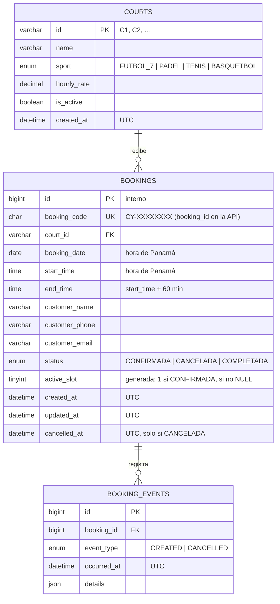

# Especificación del Modelo de Datos (SDD — Data Model)

**Proyecto:** Sistema de Reservas Especializado de Canchas Deportivas (`CanchaYa`)  
**Curso:** Tópicos Especiales II — Prof. Regis Rivera  
**Rol Responsable:** Estudiante 2 — Architecture / Development Lead (David)  
**Versión:** 1.0.0  
**Fecha:** 2026-11-15  
**Estado:** Propuesta en revisión (issue #21, cierra #14)  

---

> [!NOTE]  
> Modelo relacional para **MySQL 8.4 (InnoDB)** gestionado con **Prisma**. Se deriva de `specs/requirements.md`, `specs/business-rules.md`, `specs/api.md`, `specs/architecture.md` y de las decisiones ADR-002, ADR-006 y ADR-007.

## 1. Diagrama Entidad-Relación



---

## 2. Convenciones

| Tema | Convención |
| :--- | :--- |
| Nombres en base de datos | Tablas en plural y columnas en `snake_case` (`booking_events`, `start_time`). |
| Nombres en TypeScript | `camelCase` (`bookingEvents`, `startTime`); Prisma traduce con `@@map` y `@map`. |
| Motor y codificación | InnoDB, `utf8mb4` / `utf8mb4_0900_ai_ci` (acentos y eñes en nombres). |
| Claves primarias | Numéricas internas (`BIGINT` autoincremental) que **nunca se exponen** en la API. Excepción: `courts.id`, que es un código legible (`C1`) usado en la API y en los escenarios Gherkin. |
| Identificador público | `bookings.booking_code` es el único identificador de reserva visible para el cliente; en la API se llama `booking_id`. |
| Estados y catálogos | Enums de Prisma, que se crean como `ENUM` en MySQL. |
| Fecha y hora del turno | `DATE` + `TIME` en **hora local de America/Panama** (ADR-007). Panamá no tiene horario de verano, por lo que no hay horas repetidas ni saltadas. |
| Marcas de tiempo técnicas | `DATETIME(3)` en **UTC**. La conexión de la aplicación fija `time_zone = '+00:00'`, así `CURRENT_TIMESTAMP(3)` siempre es UTC. |
| Dinero | `DECIMAL(10,2)`; nunca números de punto flotante. |
| Integridad | Toda regla que la base de datos puede garantizar se declara también como restricción (`CHECK`, `UNIQUE`, `FOREIGN KEY`), además de validarse en el dominio. |

---

## 3. Entidades

### 3.1 `courts` — Canchas Deportivas

| Columna | Tipo | Restricciones | Regla / Origen |
| :--- | :--- | :--- | :--- |
| `id` | `VARCHAR(10)` | PK | Código legible (`C1`). Usado en `GET /courts/{id}` y en los escenarios. |
| `name` | `VARCHAR(80)` | NOT NULL | Nombre público (RF-01). |
| `sport` | `ENUM('FUTBOL_7','PADEL','TENIS','BASQUETBOL')` | NOT NULL | Deportes de RF-01. |
| `hourly_rate` | `DECIMAL(10,2)` | NOT NULL, `CHECK (hourly_rate > 0)` | Tarifa por hora (RF-01). |
| `is_active` | `BOOLEAN` | NOT NULL, DEFAULT `TRUE` | Estado operativo. En la v1 solo se cambia por datos semilla (ADR-006). |
| `created_at` | `DATETIME(3)` | NOT NULL, DEFAULT `CURRENT_TIMESTAMP(3)` | UTC. |

### 3.2 `bookings` — Reservas de Turnos

| Columna | Tipo | Restricciones | Regla / Origen |
| :--- | :--- | :--- | :--- |
| `id` | `BIGINT UNSIGNED` | PK, AUTO_INCREMENT | Clave interna; no se expone. |
| `booking_code` | `CHAR(11)` ASCII binario | NOT NULL, UNIQUE, `CHECK` de formato | `CY-` + 8 caracteres del alfabeto `23456789ABCDEFGHJKLMNPQRSTUVWXYZ` (BR-03, RF-04, ADR-002). |
| `court_id` | `VARCHAR(10)` | NOT NULL, FK → `courts.id` | Cancha reservada. `ON DELETE RESTRICT`: no se puede borrar una cancha con reservas. |
| `booking_date` | `DATE` | NOT NULL | Fecha del turno en hora de Panamá. |
| `start_time` | `TIME` | NOT NULL, `CHECK (start_time >= '08:00:00')` | Inicio del turno (BR-02). |
| `end_time` | `TIME` | NOT NULL, `CHECK (end_time > start_time AND end_time <= '23:00:00')` | Calculado por el servidor: `start_time + 60 min` (RF-03). |
| `customer_name` | `VARCHAR(80)` | NOT NULL | 3 a 80 caracteres (BR-03; el mínimo se valida en la API). |
| `customer_phone` | `VARCHAR(25)` | NOT NULL | Se guarda como lo escribió el cliente: 7 a 15 dígitos más `+`, espacios, guiones o paréntesis (BR-03). |
| `customer_email` | `VARCHAR(254)` | NOT NULL | Longitud máxima de un correo (RFC 5321). Formato validado en la API. |
| `status` | `ENUM('CONFIRMADA','CANCELADA','COMPLETADA')` | NOT NULL, DEFAULT `'CONFIRMADA'` | Estados canónicos (BR-04, ADR-007). |
| `active_slot` | `TINYINT` generada (`STORED`) | — | `1` si `status = 'CONFIRMADA'`, `NULL` en otro caso. Base del índice anticolisión. |
| `created_at` | `DATETIME(3)` | NOT NULL, DEFAULT `CURRENT_TIMESTAMP(3)` | UTC. |
| `updated_at` | `DATETIME(3)` | NOT NULL, se actualiza sola | UTC. |
| `cancelled_at` | `DATETIME(3)` | NULL | UTC. Obligatoria si y solo si `status = 'CANCELADA'`. |

### 3.3 `booking_events` — Auditoría de Operaciones (RNF-06, issue #14)

| Columna | Tipo | Restricciones | Regla / Origen |
| :--- | :--- | :--- | :--- |
| `id` | `BIGINT UNSIGNED` | PK, AUTO_INCREMENT | — |
| `booking_id` | `BIGINT UNSIGNED` | NOT NULL, FK → `bookings.id` | Reserva afectada. |
| `event_type` | `ENUM('CREATED','CANCELLED')` | NOT NULL | Operación registrada. |
| `occurred_at` | `DATETIME(3)` | NOT NULL, DEFAULT `CURRENT_TIMESTAMP(3)` | Momento de la operación en UTC (RNF-06). |
| `details` | `JSON` | NULL | Datos de contexto opcionales, por ejemplo `{"previous_status": "CONFIRMADA"}`. |

**Reglas de la auditoría:**
* El evento se inserta **en la misma transacción** que la creación o cancelación: si una falla, ninguna queda guardada.
* La tabla es **solo de inserción**: la aplicación nunca actualiza ni borra eventos.
* No se duplican datos personales del cliente ni se guardan direcciones IP; el evento apunta a la reserva.
* El paso a `COMPLETADA` no genera evento, porque se calcula al leer (ver sección 5).

---

## 4. Índices y Restricciones de Integridad

| Nombre | Tabla | Columnas | Tipo | Propósito |
| :--- | :--- | :--- | :--- | :--- |
| `PRIMARY` | `bookings` | `id` | PK | Clave interna. |
| `uq_bookings_code` | `bookings` | `booking_code` | UNIQUE | Búsqueda por código y garantía de unicidad (RF-04). |
| `uq_bookings_active_slot` | `bookings` | `court_id, booking_date, start_time, active_slot` | UNIQUE | **Segunda barrera anticolisión** (BR-01): imposible guardar dos reservas `CONFIRMADA` en el mismo turno. Las canceladas tienen `active_slot = NULL` y MySQL permite varios `NULL`, por lo que liberan el horario. |
| `idx_bookings_court_date_status` | `bookings` | `court_id, booking_date, status` | INDEX | Consulta de disponibilidad y de solapamiento en menos de 200 ms (RNF-03). |
| `fk_bookings_court` | `bookings` | `court_id` → `courts.id` | FK | Integridad referencial. |
| `idx_booking_events_booking` | `booking_events` | `booking_id, occurred_at` | INDEX | Historial de una reserva en orden cronológico. |
| `fk_booking_events_booking` | `booking_events` | `booking_id` → `bookings.id` | FK | Integridad referencial. |

La **primera barrera anticolisión** (bloqueo `SELECT ... FOR UPDATE` de la fila de la cancha y la consulta de solapamiento de BR-01) está descrita en `specs/architecture.md`, sección 5.

---

## 5. Estados en Base de Datos y Evaluación Perezosa

* Al crear una reserva se guarda `status = 'CONFIRMADA'`.
* Al cancelar se guarda `status = 'CANCELADA'` y `cancelled_at`, y se inserta el evento `CANCELLED`.
* **`COMPLETADA` no se escribe al consultar** (ADR-007): el servicio lo calcula al leer cuando la reserva está `CONFIRMADA` y su `booking_date` + `end_time` ya pasó en hora de Panamá. Así, `GET` nunca modifica datos, que es lo esperado en una consulta HTTP.
* El valor `COMPLETADA` existe en el `ENUM` para mantener los estados canónicos y para un posible cierre masivo futuro, pero la v1 no lo persiste.
* Que una reserva pasada siga `CONFIRMADA` en la base de datos no afecta a la anticolisión, porque nadie puede reservar en el pasado (BR-02).

---

## 6. Correspondencia entre API y Base de Datos

| Campo en la API (`specs/api.md`) | Columna |
| :--- | :--- |
| `booking_id` | `bookings.booking_code` |
| `court_id` | `bookings.court_id` |
| `date` | `bookings.booking_date` |
| `start_time` / `end_time` | `bookings.start_time` / `bookings.end_time` (formato `HH:mm`) |
| `customer_name` / `customer_phone` / `customer_email` | Columnas del mismo nombre |
| `status` | `bookings.status`, o `COMPLETADA` calculado al leer |
| `created_at` | `bookings.created_at` (ISO 8601 con sufijo `Z`) |

El `id` numérico interno y la tabla `booking_events` no aparecen en ninguna respuesta de la API.

---

## 7. Trazabilidad con Reglas y Requisitos

| Regla / Requisito | Cómo lo cubre el modelo |
| :--- | :--- |
| **BR-01 / RNF-01** Cero doble reserva | `uq_bookings_active_slot` + bloqueo de la fila en `courts` |
| **BR-02** Rango 08:00–23:00 | `CHECK` de `start_time` y `end_time` |
| **BR-03 / RF-04** Código seguro | `booking_code` único con `CHECK` de formato y alfabeto |
| **BR-04** Estados canónicos | `ENUM` de `status` + `CHECK` de `cancelled_at` |
| **RF-01** Catálogo | Tabla `courts` con deporte, tarifa y estado |
| **RNF-03** < 200 ms | `idx_bookings_court_date_status` |
| **RNF-06** Auditoría UTC | Tabla `booking_events` |
| **ADR-006** Sin administrador | Canchas cargadas por datos semilla; sin tablas de usuarios |
| **ADR-007** Panamá / UTC | `DATE` + `TIME` locales; `DATETIME(3)` en UTC |

---

## 8. Datos Iniciales (Seed)

Las canchas coinciden con las usadas en `specs/acceptance-criteria.md`. Las tarifas son **valores de ejemplo** y pueden ajustarse.

| `id` | `name` | `sport` | `hourly_rate` | `is_active` |
| :--- | :--- | :--- | ---: | :---: |
| `C1` | Cancha 1 - Fútbol 7 Sintético | `FUTBOL_7` | 60.00 | ✅ |
| `C2` | Cancha 2 - Pádel | `PADEL` | 30.00 | ✅ |
| `C3` | Cancha 3 - Tenis | `TENIS` | 25.00 | ✅ |
| `C4` | Cancha 4 - Básquetbol | `BASQUETBOL` | 20.00 | ✅ |

---

## 9. DDL de Referencia (MySQL 8.4)

> Fuente de verdad durante la implementación: el esquema de Prisma y sus migraciones (TASK-10). Este DDL documenta el resultado esperado. Prisma no modela columnas generadas ni restricciones `CHECK`, por lo que `active_slot`, su índice único y los `CHECK` se agregan en una **migración SQL manual** (`prisma migrate dev --create-only`); en TASK-10 se comprobará que las migraciones siguientes no los reviertan.

```sql
CREATE TABLE courts (
  id           VARCHAR(10)   NOT NULL,
  name         VARCHAR(80)   NOT NULL,
  sport        ENUM('FUTBOL_7','PADEL','TENIS','BASQUETBOL') NOT NULL,
  hourly_rate  DECIMAL(10,2) NOT NULL,
  is_active    BOOLEAN       NOT NULL DEFAULT TRUE,
  created_at   DATETIME(3)   NOT NULL DEFAULT CURRENT_TIMESTAMP(3),
  PRIMARY KEY (id),
  CONSTRAINT chk_courts_rate CHECK (hourly_rate > 0)
) ENGINE=InnoDB DEFAULT CHARSET=utf8mb4 COLLATE=utf8mb4_0900_ai_ci;

CREATE TABLE bookings (
  id              BIGINT UNSIGNED NOT NULL AUTO_INCREMENT,
  booking_code    CHAR(11) CHARACTER SET ascii COLLATE ascii_bin NOT NULL,
  court_id        VARCHAR(10)  NOT NULL,
  booking_date    DATE         NOT NULL,
  start_time      TIME         NOT NULL,
  end_time        TIME         NOT NULL,
  customer_name   VARCHAR(80)  NOT NULL,
  customer_phone  VARCHAR(25)  NOT NULL,
  customer_email  VARCHAR(254) NOT NULL,
  status          ENUM('CONFIRMADA','CANCELADA','COMPLETADA') NOT NULL DEFAULT 'CONFIRMADA',
  active_slot     TINYINT GENERATED ALWAYS AS
                    (CASE WHEN status = 'CONFIRMADA' THEN 1 ELSE NULL END) STORED,
  created_at      DATETIME(3)  NOT NULL DEFAULT CURRENT_TIMESTAMP(3),
  updated_at      DATETIME(3)  NOT NULL DEFAULT CURRENT_TIMESTAMP(3)
                    ON UPDATE CURRENT_TIMESTAMP(3),
  cancelled_at    DATETIME(3)  NULL,
  PRIMARY KEY (id),
  UNIQUE KEY uq_bookings_code (booking_code),
  UNIQUE KEY uq_bookings_active_slot (court_id, booking_date, start_time, active_slot),
  KEY idx_bookings_court_date_status (court_id, booking_date, status),
  CONSTRAINT fk_bookings_court FOREIGN KEY (court_id) REFERENCES courts (id)
    ON UPDATE CASCADE ON DELETE RESTRICT,
  CONSTRAINT chk_bookings_code
    CHECK (REGEXP_LIKE(booking_code, '^CY-[2-9A-HJ-NP-Z]{8}$', 'c')),
  CONSTRAINT chk_bookings_start CHECK (start_time >= '08:00:00'),
  CONSTRAINT chk_bookings_end CHECK (end_time > start_time AND end_time <= '23:00:00'),
  CONSTRAINT chk_bookings_cancelled
    CHECK ((status = 'CANCELADA') = (cancelled_at IS NOT NULL))
) ENGINE=InnoDB DEFAULT CHARSET=utf8mb4 COLLATE=utf8mb4_0900_ai_ci;

CREATE TABLE booking_events (
  id           BIGINT UNSIGNED NOT NULL AUTO_INCREMENT,
  booking_id   BIGINT UNSIGNED NOT NULL,
  event_type   ENUM('CREATED','CANCELLED') NOT NULL,
  occurred_at  DATETIME(3)  NOT NULL DEFAULT CURRENT_TIMESTAMP(3),
  details      JSON         NULL,
  PRIMARY KEY (id),
  KEY idx_booking_events_booking (booking_id, occurred_at),
  CONSTRAINT fk_booking_events_booking FOREIGN KEY (booking_id) REFERENCES bookings (id)
    ON UPDATE RESTRICT ON DELETE RESTRICT
) ENGINE=InnoDB DEFAULT CHARSET=utf8mb4 COLLATE=utf8mb4_0900_ai_ci;
```

---

## 10. Impacto del Cambio de Requerimiento (Buffer de 15 min, issue #16)

* La columna `active_slot` y su índice único solo impiden reservas con **el mismo inicio**. El margen de 15 minutos entre turnos lo controla la consulta de solapamiento del servicio (barrera principal), que recibirá el margen como parámetro.
* Si el Product Lead elige redefinir la grilla (por ejemplo, bloques cada 75 minutos), el modelo no cambia: `start_time` y `end_time` ya admiten cualquier minuto y los `CHECK` solo exigen el rango 08:00–23:00.
