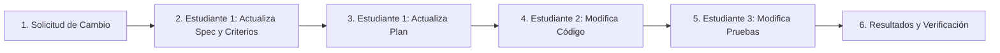

# Plan de Implementación y Backlog de Tareas (SDD — Implementation Plan)

**Proyecto:** Sistema de Reservas Especializado de Canchas Deportivas (`CanchaYa`)  
**Curso:** Tópicos Especiales II — Prof. Regis Rivera  
**Rol Responsable:** Estudiante 1 — Product / Spec Lead (Ivan Wu)  
**Destinatarios:** Estudiante 2 (David - Dev Lead) y Estudiante 3 (QA Lead)  
**Versión:** 1.0.0  

---

## 1. Matriz de Responsabilidades y Roles del Equipo

| Estudiante | Rol Asignado | Responsabilidades Primarias | Entregables Clave |
| :--- | :--- | :--- | :--- |
| **Estudiante 1** *(Ivan Wu)* | **Product / Spec Lead** | Requisitos, ODD, SDD, Reglas de Negocio, Criterios de Aceptación, Backlog y Gestión de Cambios de Especificación. | `specs/outcomes.md`, `specs/requirements.md`, `specs/business-rules.md`, `specs/acceptance-criteria.md`, `specs/implementation-plan.md`, `docs/decisions.md`, `docs/ai-log.md`. |
| **Estudiante 2** *(David)* | **Architecture / Dev Lead** | Definición de Stack tecnológico, Arquitectura de Software, Modelo Entidad-Relación, Contratos API e Implementación del Código Fuente. | `specs/architecture.md`, `specs/data-model.md`, `specs/api.md`, código en `src/`. |
| **Estudiante 3** | **QA / DevOps Lead** | Estrategia de Pruebas Automatizadas, Tests de Criterios de Aceptación, Test de Anticolisión (No Doble Reserva), Pipeline CI y Despliegue. | `docs/testing.md`, suites en `tests/`, workflows de integración continua. |

---

## 2. Desglose de Fases y Milestones (Backlog de Trabajo)

### Milestone 1: Especificación y Gobernanza (Liderado por Estudiante 1 - COMPLETADO)
* [x] **TASK-01:** Diagnóstico de Pain Points y Definición de Outcomes bajo ODD (`specs/outcomes.md`).
* [x] **TASK-02:** Levantamiento de Historias de Usuario, Requisitos Funcionales y No Funcionales (`specs/requirements.md`).
* [x] **TASK-03:** Modelado riguroso de Reglas de Negocio y prevención matemática de colisión (`specs/business-rules.md`).
* [x] **TASK-04:** Redacción de Criterios de Aceptación en formato Gherkin/BDD (`specs/acceptance-criteria.md`).
* [x] **TASK-05:** Inicialización del Repositorio Git y plantillas Spec-Kit (`.specify`).
* [x] **TASK-06:** Estructuración de Bitácora de Inteligencia Artificial (`docs/ai-log.md`) y Decisiones de Producto (`docs/decisions.md`).

---

### Milestone 2: Arquitectura y Diseño Técnico (Para Estudiante 2 - David)
* [ ] **TASK-07:** Selección del Stack Tecnológico (Backend, Framework, Base de Datos Ligera) documentado en `specs/architecture.md`.
* [ ] **TASK-08:** Diseño del Esquema de Datos Relacional (Tablas: `courts`, `bookings`) en `specs/data-model.md`.
* [ ] **TASK-09:** Especificación OpenAPI / REST Contract (`GET /courts`, `GET /courts/{id}/availability`, `POST /bookings`, `GET /bookings/{id}`, `DELETE /bookings/{id}`) en `specs/api.md`.
* [ ] **TASK-10:** Andamiaje del proyecto en la carpeta `src/`.

---

### Milestone 3: Implementación Core de Reservas y Reglas Críticas (Para Estudiante 2 - David)
* [ ] **TASK-11:** Implementación del catálogo de canchas y cálculo de slots disponibles (08:00 - 23:00).
* [ ] **TASK-12:** Implementación del endpoint de creación de reserva con generación de `booking_id` alfanumérico único.
* [ ] **TASK-13:** **Implementación del algoritmo de validación de no colisión (BR-01):**
  * Validación atómica a nivel de consulta/transacción SQL:
    ```sql
    WHERE court_id = :court_id 
      AND status = 'CONFIRMADA'
      AND (:start_time < end_time AND :end_time > start_time)
    ```
* [ ] **TASK-14:** Implementación de endpoints de consulta por `booking_id` y cancelación autónoma (con validación de 2 horas previas).
* [ ] **TASK-15:** Interfaz de usuario ligera (Frontend Web HTML/Tailwind/React/Vue o plantilla SSR) para flujo completo sin login.

---

### Milestone 4: Aseguramiento de Calidad y Pruebas Automatizadas (Para Estudiante 3 - QA Lead)
* [ ] **TASK-16:** Planificación de la suite de pruebas en `docs/testing.md`.
* [ ] **TASK-17 (OBLIGATORIA):** Creación del test automatizado de **No Doble Reserva** en `tests/test_conflict.py`:
  * Crear reserva inicial A.
  * Intentar crear reserva B en horario coincidente $\rightarrow$ Aserción: Retornar HTTP 409 y 0 reservas duplicadas.
* [ ] **TASK-18:** Pruebas de reglas de tiempo (rechazo de reservas en el pasado, fuera de horario operativo 08:00-23:00).
* [ ] **TASK-19:** Pruebas de cancelación a tiempo vs cancelación tardía (< 2 horas).
* [ ] **TASK-20:** Configuración de GitHub Actions para ejecución automática de pruebas en cada Push/PR.

---

### Milestone 5: Simulación Obligatoria de Cambio de Especificación (Ciclo Completo)
*(Requisito curricular de la rúbrica: introducir un cambio inesperado y mostrar evidencia de su ciclo completo)*



* **Detalle del Cambio Simulado:**  
  * *Requerimiento:* **Buffer de Mantenimiento Obligatorio de 15 Minutos entre Turnos.**
  * *Impacto en Especificación:* La cancha requiere 15 min de limpieza y acondicionamiento. Ningún partido puede comenzar inmediatamente al terminar otro; debe haber 15 min de separación mínima.
* **Secuencia de Commits Evidenciables:**
  1. Commit Estudiante 1: `docs(specs): add 15-minute maintenance buffer rule (BR-06)` + actualización de criterios de aceptación.
  2. Commit Estudiante 2: `feat(core): apply maintenance buffer validation in booking conflict service`.
  3. Commit Estudiante 3: `test(qa): add automated test verifying buffer violation rejection`.

---

## 3. Criterio de "Listo para Pasar al Dev Lead" (Definition of Ready)
Las especificaciones entregadas por el Estudiante 1 (Ivan Wu) se declaran **LISTAS** para desarrollo cuando:
1. No existen ambigüedades sobre los parámetros de entrada y salida de las reservas.
2. La fórmula matemática para detectar conflictos de horarios está formalizada.
3. Los criterios de aceptación en Gherkin cubren casos positivos, límites y de error.
4. El backlog de tareas está priorizado y documentado.
